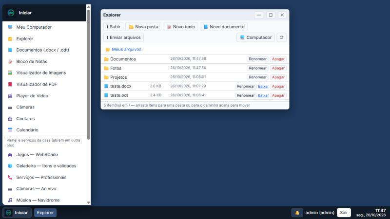

# Diogows

Uma **área de trabalho no navegador** para a casa: janelas, menu Iniciar, ícones e barra de tarefas, com **login e vários usuários**.
Explorer, editor de documentos/planilhas/apresentações, e-mail (Gmail e Outlook), mensagens, calendário, navegador, Paint, player de música, emuladores, programas DOS e muito mais,
em qualquer navegador (PC, tablet, celular ou TV). Um único programa em Go, que cabe numa máquina de 2 GB de RAM.



> ⚠️ **Uso doméstico.** O Diogows tem login, mas é feito para uma **rede de casa confiável** e, em HTTP puro, as senhas trafegam sem criptografia. **Não o exponha à internet**;
> para acesso de fora use uma VPN (Tailscale, WireGuard) ou um proxy com HTTPS. Veja [SECURITY.md](SECURITY.md).

O Diogows é independente da **[Central Diogo](https://github.com/exadmax/DVRCentral)** (o painel da casa: agenda, clima, trânsito, câmeras, estoque, livros), com quem já dividiu o mesmo programa.
Funciona sozinho; se a Central estiver por perto, ele mostra as câmeras, os contatos e as agendas da casa. Veja [docs/como-funciona/central.md](docs/como-funciona/central.md).

## Sumário
- [Funcionalidades](#funcionalidades)
- [Começando](#começando)
- [Configuração](#configuração)
- [Instalação no servidor](#instalação-no-servidor)
- [Como o projeto funciona](#como-o-projeto-funciona)
- [Estrutura do repositório](#estrutura-do-repositório)
- [Testes](#testes)
- [Documentação](#documentação)
- [Licença](#licença)

## Funcionalidades

| Área | O que tem |
|---|---|
| **Área de trabalho** | Janelas, menu Iniciar por categorias com busca e "mais usados", ícones, barra de tarefas, menu de contexto, temas, celular e tablet |
| **Arquivos** | Explorer com a pasta própria de cada usuário, envio e download, visualizadores (texto, imagem, PDF, vídeo), Zip Manager |
| **Escritório** | LiteOffice: documentos (.docx/.odt), planilhas (.xlsx/.ods, com fórmulas) e apresentações (.pptx/.odp) leves; LiteOffice **Completo** (LibreOffice em WebAssembly); Bloco de Notas, Calculadora |
| **Comunicação** | **E-mail** (várias contas, IMAP/SMTP e login OAuth do Gmail e Outlook), **Mensagens** entre os usuários, **Calendário** (agendas iCal), **Contatos** |
| **Internet** | Navegador interno (o servidor busca e limpa a página), downloads, **Programa Web** (qualquer site vira um app, com o ícone dele) |
| **Mídia e jogos** | Paint (JS Paint), Player de Música (Webamp), Player de Vídeo, Campo Minado, Paciência, FreeCell, **emuladores** (Mega Drive, SNES, Game Boy, Atari...) |
| **Programas antigos** | Programas **DOS** e sistemas virtuais (Windows 3.x a ME, com sua licença) no navegador, com disco salvo no servidor |
| **Casa** | Câmeras ao vivo, planta da casa com as TVs e seus estados (a Central fornece as câmeras) |
| **Administração** | Usuários e permissões, **Terminal** e arquivos do computador (opcional, com `sudo`), Painel de Controle, Atualizações dos componentes de terceiros |

Detalhes de cada aplicativo em [docs/desktop.md](docs/desktop.md), [docs/aplicativos.md](docs/aplicativos.md), [docs/email.md](docs/email.md) e [docs/emuladores.md](docs/emuladores.md).

## Começando

Precisa só do [Go](https://go.dev/dl/) (versão em `server/go.mod`):

```bash
cd server
cp diogows.config.example.json diogows.config.json
go run .
```

Abra <http://localhost:8090>. Na primeira vez o **log** mostra a senha inicial do usuário `admin` (a troca é obrigatória no primeiro login).
Para ver câmeras, contatos e agendas, suba a [Central Diogo](https://github.com/exadmax/DVRCentral) na porta 8080; sem ela, esses itens aparecem como "indisponível".

## Configuração

O arquivo `diogows.config.json` (modelo em [`server/diogows.config.example.json`](server/diogows.config.example.json)). **Tudo é opcional.**

| Campo | Padrão | O que faz |
|---|---|---|
| `listen` | `:8090` | Endereço e porta |
| `staticDir` | `../www` | Pasta do front-end (relativa ao arquivo de configuração) |
| `dbPath` | `diogows.db` | Banco SQLite |
| `central.url` | vazio | Endereço da Central Diogo (ex.: `http://127.0.0.1:80`); vazio desliga a ligação |
| `videos.dir` | `~/Videos` | Pasta da biblioteca do Player de Vídeo |
| `desk.dir` | `desk` | Onde ficam as pastas dos usuários |
| `desk.shell` | `false` | Liga o **Terminal** e os arquivos do computador (leia o [SECURITY.md](SECURITY.md)) |
| `desk.shellAnyNetwork` | `false` | Permite o Terminal por HTTP vindo de fora das redes privadas (não recomendado) |
| `desk.noBrowser` | `false` | Tira o Navegador, os downloads e a busca de ícones de sites |
| `desk.maxUploadMB` | `2048` | Tamanho máximo de cada envio |
| `desk.mail` | `{}` | `redirectURI`, `allowPrivate`, `disabled` ([docs/email.md](docs/email.md)) |
| `desk.updates` | `{}` | `checkDays`, `disabled` ([docs/atualizacoes.md](docs/atualizacoes.md)) |
| `desk.disabled` | `false` | Desliga o Diogows inteiro (`/api/desk/*` some) |
| `games` | — | Chaves do placar de jogos, sem tela ([docs/jogos.md](docs/jogos.md)) |

No navegador, `www/config/settings.js` (opcional, ignorado pelo git) ajusta o endereço da Central usado nos links. Veja [docs/como-funciona/frontend.md](docs/como-funciona/frontend.md#configuração-do-navegador-configsettingsjs).

## Instalação no servidor

Gere os pacotes no seu PC e instale no servidor Linux (ou use o instalador em janela do Windows):

```bash
cd server && ./package.sh v1.0.0          # gera server/dist/diogows.tgz e diogows-windows.zip
# no servidor, com o pacote extraído:
sudo bash install.sh                      # /opt/diogows, porta 8090, serviço "diogows"
```

O Diogows roda como **um serviço independente**, ao lado da Central Diogo, do Navidrome e dos demais, e é atualizado sem mexer neles. Se você já usava o Diogows quando ele fazia parte da Central:

```bash
sudo bash install.sh --import-central /opt/centraldiogo     # leva usuários, mensagens, e-mails e arquivos
```

Passo a passo em [docs/como-funciona/implantacao.md](docs/como-funciona/implantacao.md) e [docs/como-funciona/migracao-da-central.md](docs/como-funciona/migracao-da-central.md).

## Como o projeto funciona

A pasta [**docs/como-funciona/**](docs/como-funciona/README.md) ensina o projeto por dentro:

| | |
|---|---|
| [Visão geral](docs/como-funciona/visao-geral.md) | O que é, o que não é, decisões de projeto |
| [Arquitetura](docs/como-funciona/arquitetura.md) | Servidor, front-end e o caminho de um pedido |
| [O servidor (Go)](docs/como-funciona/backend.md) | Arquivos, rotas, sessão, permissões, banco |
| [O front-end](docs/como-funciona/frontend.md) | `DK`, janelas, aplicativos, carregamento sob demanda |
| [A Central Diogo](docs/como-funciona/central.md) | A ponte com o painel da casa |
| [Os dados](docs/como-funciona/dados.md) | Onde ficam banco, arquivos e chaves; backup |
| [Segurança](docs/como-funciona/seguranca.md) | Onde cada regra vive no código |
| [Desenvolvimento](docs/como-funciona/desenvolvimento.md) | Rodar, testar e receitas (novo app, nova rota, nova migração) |
| [Implantação](docs/como-funciona/implantacao.md) | Empacotar, instalar, versões |

## Estrutura do repositório

```text
server/     o programa em Go (módulo "diogows"): main.go, desk*.go, central.go, db.go, install.sh, windows/
www/        o front-end (JavaScript puro, sem build): desktop.html, js/desktop/, css/, vendor/
docs/       guias de uso (desktop.md, email.md, ...) e como-funciona/ (como o projeto funciona)
scripts/    check-i18n.js
```

## Testes

```bash
cd server && go vet ./... && go test ./...
node scripts/check-i18n.js
```

## Documentação

| Guia | Assunto |
|---|---|
| [docs/como-funciona/](docs/como-funciona/README.md) | **Como o projeto funciona** (comece por aqui para mexer no código) |
| [docs/desktop.md](docs/desktop.md) | Usuários, permissões, Terminal/sudo, calendário, LiteOffice, API |
| [docs/aplicativos.md](docs/aplicativos.md) | Programa Web, Paint, Player de Música, Jogos, perfil, menu Iniciar |
| [docs/email.md](docs/email.md) | Ligar contas, OAuth (Gmail e Outlook), segurança |
| [docs/emuladores.md](docs/emuladores.md) | Consoles no navegador (ROMs suas) |
| [docs/atualizacoes.md](docs/atualizacoes.md) | Atualização dos componentes de terceiros |
| [docs/licencas.md](docs/licencas.md) | Licenças dos componentes de terceiros |
| [docs/jogos.md](docs/jogos.md) | Placar de jogos (sem tela) |
| [docs/versionamento.md](docs/versionamento.md) | Versões e releases |
| [docs/novidades.md](docs/novidades.md) | Notas da próxima versão |
| [SECURITY.md](SECURITY.md) | Modelo de ameaça e proteções |

## Licença

[GNU GPL v3](LICENSE). Os componentes de terceiros mantêm as próprias licenças ([docs/licencas.md](docs/licencas.md)).
